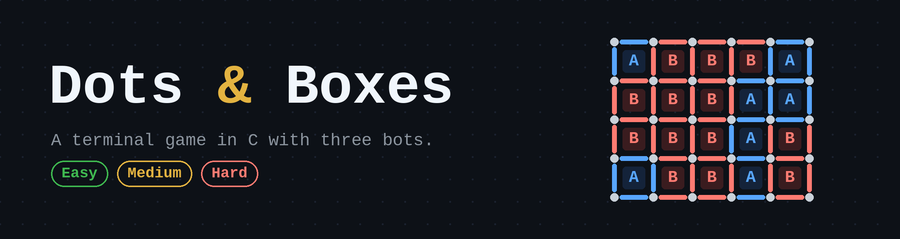
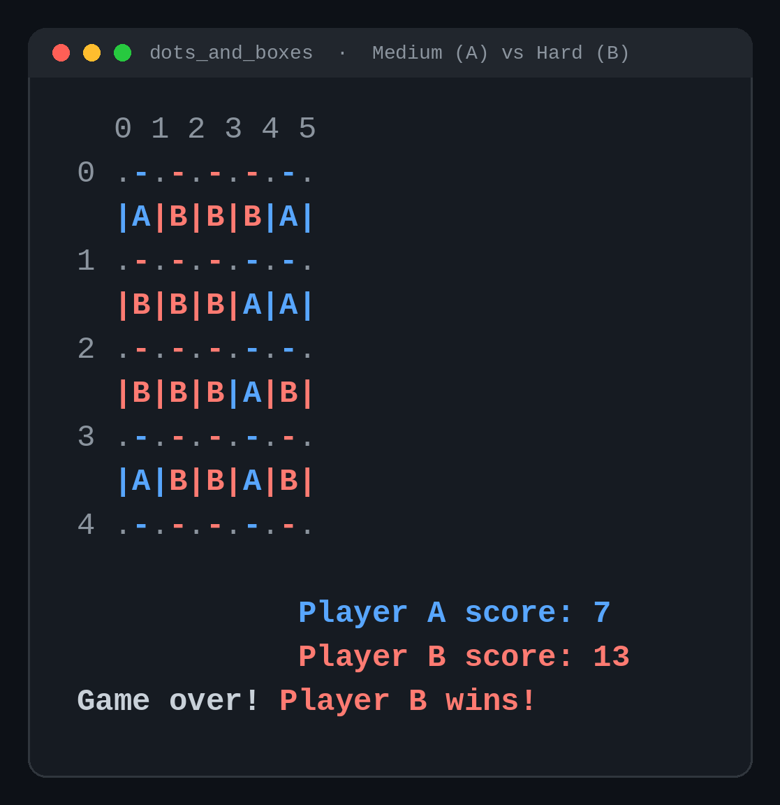

<div align="center">



<br>


**Play Dots and Boxes in your terminal against a bot you can turn up from random to ruthless.**

</div>

<br>

<div align="center">

<br>
<sub>A real game from this code: Medium (A, blue) against Hard (B, red). Hard wins 13 to 7.</sub>
</div>

## 🎮 How to play

```bash
make run
```

Pick a mode, then pick who moves first. You are **Player A** (blue), the bot is **Player B** (red).

| Mode | Opponent |
|---|---|
| `1` | Another human |
| `2` | Bot, Easy |
| `3` | Bot, Medium |
| `4` | Bot, Hard |

Enter a move as the row and column of two **adjacent dots**, for example `0 0 0 1`. Type `exit` to quit.

Closing the fourth side of a box claims it and gives you another turn. One line can close two boxes at once. The board is 4 × 5 boxes, and the player with the most boxes wins.

## 🤖 The bots

| Bot | How it plays |
|---|---|
| **Easy** | Picks a random legal line. |
| **Medium** | Tries every legal line on a copy of the board, plays the one that completes the most boxes, and falls back to a random line if none completes a box. The search is split across **two pthreads**, one scanning horizontal lines and one scanning vertical lines, with a mutex guarding the shared best move. |
| **Hard** | Plays like Medium for the first 20 of the 49 moves, where the branching is too wide to search. After that it runs a **depth-5 minimax with alpha-beta pruning**, scoring positions by the score difference. The search follows the extra-turn rule: the turn only passes to the other player when no box was completed. |

The team tried threading the minimax search first, then went back to a single-threaded Hard bot because it ran faster.

## 🛠️ Build and test

```bash
make          # build ./dots_and_boxes
make run      # build and play
make test     # unit tests for the rules and the bots
```

Needs `gcc` and POSIX threads. Built and tested on Linux. Without `make`:

```bash
gcc -pthread dots_and_boxes.c Logic.c Bot.c -o dots_and_boxes -lm
```

## 🧱 Under the hood

```
.
├── dots_and_boxes.c   # menu and game loop
├── Logic.c            # rules, move validation, box claiming, board printing
├── Bot.c              # Easy, Medium (threaded) and Hard (minimax) bots
├── game.h             # shared types, constants and prototypes
├── test_logic.c       # unit tests for the rules
├── test_bot.c         # unit tests for the bots
└── Makefile
```

- **One `GameState` struct** holds the lines, box owners, scores, whose turn it is and the printable board.
- **Every move is validated** for adjacency, orientation, bounds and whether the line is already taken, and each failure returns its own error code.
- **Bots never touch the real game while thinking.** They simulate on a copy of the state passed by value.

Board size and search depth are `#define`s in `game.h` (`ROWS`, `COLS`, `MAX_DEPTH`).

<br>

<div align="center">

**Team:** Ameera Albahrani · Hashem Awad · Ahmad Faleh · Mazen Hachem

<sub>Forked from <a href="https://github.com/ameerabahrani/3askar-Multi-threaded-Dots-And-Boxes-Game">ameerabahrani/3askar-Multi-threaded-Dots-And-Boxes-Game</a></sub>

</div>
